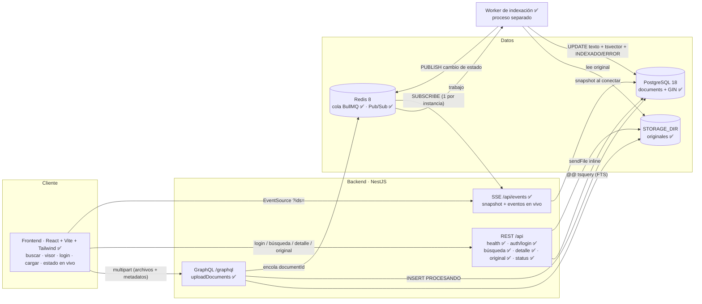
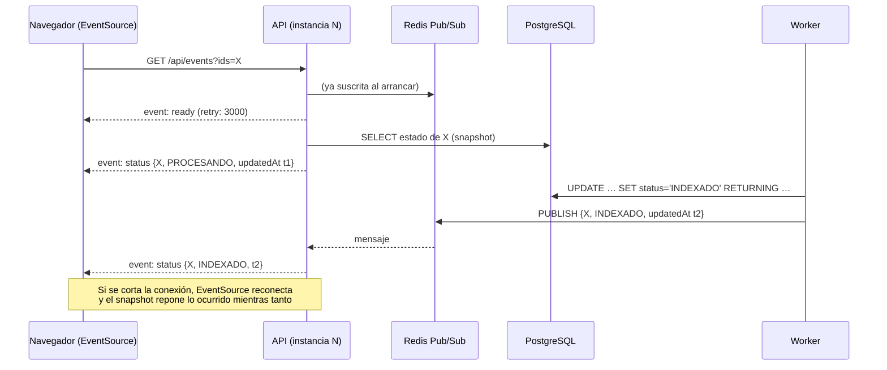

# Arquitectura

> Documento vivo: se actualiza al cerrar cada bloque. Las secciones marcadas *(pendiente)* describen el diseño previsto y todavía no están implementadas.

## 1. Diagrama de arquitectura y flujo

Líneas continuas: implementado. Líneas punteadas: pendiente.

### Flujo de carga (HU-01)

1. ✅ El administrador inicia sesión (`POST /api/auth/login`) y obtiene un JWT de 8 h.
2. ✅ Un middleware rechaza con 401 cualquier petición multipart a `/graphql` sin un Bearer válido, **antes** de leer los archivos.
3. ✅ El cliente envía la mutación `uploadDocuments(files, input)` como `multipart/form-data`. `input.documents[i]` contiene los metadatos de `files[i]`.
4. ✅ El middleware `graphql-upload` interpreta el multipart y aplica `MAX_UPLOAD_BYTES` y `MAX_FILES_PER_UPLOAD`. Apollo rechaza la petición sin la cabecera de preflight (CSRF).
5. ✅ `GqlAuthGuard` vuelve a verificar el token en el resolver, y `ValidationPipe` valida y normaliza los metadatos.
6. ✅ Por cada archivo:
   1. Se valida la extensión.
   2. Se guarda por streaming con un UUID como nombre.
   3. Se verifica que el contenido corresponda a la extensión.
   4. Se inserta la fila `PROCESANDO`.
7. ✅ Se encola el `documentId` en BullMQ (`jobId = documentId`).
8. ✅ La respuesta devuelve `id` + `PROCESANDO` por archivo, sin esperar a la indexación.
9. ✅ El worker (proceso separado) toma el trabajo, lee el original, extrae el texto y, en un solo `UPDATE`, guarda el texto y el `search_vector` y cambia el estado a `INDEXADO`. Ante un fallo del propio documento, el estado pasa a `ERROR` con su causa.
10. ✅ El worker publica el cambio de estado en Redis Pub/Sub (con los datos de `UPDATE … RETURNING`), y cada instancia de la API lo reenvía por SSE a los clientes que siguen ese documento.

### Flujo de búsqueda y visor (HU-02, HU-03)

1. `GET /api/documents?query=…&page=…&pageSize=…` → `ValidationPipe` (query ≤ 200 caracteres, página ≤ 1000, tamaño ≤ 50).
2. Una sola consulta SQL parametrizada:
   1. la CTE `page` filtra `status = 'INDEXADO' AND search_vector @@ websearch_to_tsquery('simple', $1)` con el índice GIN;
   2. ordena por `ts_rank_cd DESC, created_at DESC, id DESC` y calcula el total con `count(*) OVER ()`;
   3. aplica `LIMIT/OFFSET`;
   4. **solo para las filas de la página** calcula `ts_headline` del título y del contenido.
3. Los marcadores de `ts_headline` (caracteres de control) se convierten en segmentos `{ text, match }`.
4. Detalle: `GET /api/documents/:id` (metadatos y estado). Visor: `GET /api/documents/:id/original` sirve el archivo `inline` con su tipo real.

### Responsabilidad de los módulos

| Módulo | Responsabilidad | Estado |
|---|---|---|
| `common/` | Configuración desde el entorno y health check | ✅ |
| `database/` | Configuración de TypeORM y migraciones SQL | ✅ |
| `documents/` | Entidad, carga y almacenamiento, validación de archivos, DTOs | ✅ |
| `graphql/` | Resolvers GraphQL (`uploadDocuments`, `uploadLimits`) | ✅ |
| `auth/` | Login del administrador, emisión y verificación de JWT, guard GraphQL, límite de intentos | ✅ |
| `indexing/` | Cola BullMQ, worker (`worker.ts`), extracción TXT/MD/PDF, construcción del `tsvector`, reintentos y reconciliación | ✅ |
| `search/` | Consulta FTS parametrizada, ranking, paginación y resaltado seguro | ✅ |
| `documents/` (lectura) | Detalle, estado y archivo original (`DocumentsController`) | ✅ |
| `events/` | `StatusPublisher` (worker → Redis), `StatusStream` (Redis → API) y `EventsController` (SSE con snapshot) | ✅ |

**Estilo de arquitectura:** modular por capas, con un módulo NestJS por capacidad (resolver/controlador → servicio → repositorio) y un worker en proceso separado. Se descartó una arquitectura hexagonal completa (puertos y adaptadores para cada dependencia): para un alcance de un día añade interfaces de una sola implementación sin beneficio práctico. La separación por módulos ya aísla las responsabilidades y permite extraer el worker o el motor de búsqueda más adelante.

## 2. Justificación de decisiones

### Stack

| Elección | Alternativas consideradas | Motivo |
|---|---|---|
| **NestJS 12** | Express, FastAPI, Spring Boot | Módulos, inyección de dependencias, pipes y guards nativos; TypeScript en todo el stack. La v12 es ESM nativo |
| **GraphQL multipart para la carga** | REST multipart | Aclaración posterior al enunciado. Una sola mutación tipada recibe archivos y metadatos |
| **PostgreSQL FTS** (`tsvector` + GIN) | Elasticsearch, OpenSearch, Meilisearch | Datos e índice en una sola tecnología: sin sincronización entre sistemas y sin un servicio extra que operar. Un motor dedicado se justificaría si las mediciones o el volumen lo exigen |
| **TypeORM** | SQL puro, Prisma | Repositorios y migraciones integrados con Nest. El SQL crítico (esquema FTS, consultas de búsqueda) se escribe a mano y parametrizado, sin depender de las abstracciones del ORM |
| **BullMQ + Redis** | Procesar dentro de la petición; cola en PostgreSQL (`SKIP LOCKED`) | La extracción de PDF puede tardar; la cola desacopla la respuesta, da reintentos y permite escalar workers |
| **SSE** | WebSocket, suscripciones GraphQL | Solo se necesita comunicación servidor → cliente. SSE funciona sobre HTTP con reconexión nativa y sin protocolo adicional |
| **Vitest + Supertest** | Jest | Es el runner que genera el CLI de Nest 12; el mismo runner se usará en el frontend |

### Versiones de dependencias

| Hallazgo | Decisión |
|---|---|
| `graphql-upload@18` exige `graphql@17`, pero Apollo Server 5 solo admite `graphql@16` | `graphql-upload@17.1` + `graphql@16` |
| npm 10.9 falla al resolver los *peer dependencies* (`edgesOut`) | Instalación con npm 11 |
| El CLI generó `vite-tsconfig-paths` y `@nestjs/mau` | Eliminados: sin alias de rutas ni despliegue en Mau |

### Carga de documentos

| Decisión | Motivo |
|---|---|
| Archivos y metadatos en argumentos separados, emparejados por índice | La validación de DTOs nunca recorre los streams de los archivos (`Promise<FileUpload>`) |
| Resultado por archivo (`id`+`status` **o** `error`) | En una carga masiva, un archivo inválido no bloquea al resto |
| Validación del contenido real: firma `%PDF-`; UTF-8 sin bytes nulos para TXT/MD | La extensión y el `mimetype` los decide el cliente |
| Nombre en disco = UUID; nombre original saneado solo como metadato | Evita *path traversal* y rutas adivinables |
| `MAX_UPLOAD_BYTES` = 10 MB, inclusivo y configurable | El enunciado no fija un valor; 10 MB es la orientación acordada. busboy corta al **alcanzar** el límite, por eso se le pasa `límite + 1` |
| `csrfPrevention` de Apollo activo | Un formulario de otro sitio puede enviar `multipart/form-data` sin preflight CORS; exigir una cabecera personalizada lo impide |
| HTTP 200 con `PROCESANDO` en el payload (no 202) | En GraphQL el código HTTP indica que la operación se procesó; el estado asíncrono del documento va en los datos |

### Modelo de permisos: administrador único

| Acción | Acceso |
|---|---|
| Subir documentos (`uploadDocuments`) | Solo administrador (JWT) |
| Buscar, ver detalle y visor, consultar `uploadLimits`, health | Público |
| Registro, recuperación de contraseña, roles | No existen (fuera de alcance) |

El enunciado define el actor de HU-01 como "Administrador / Desarrollador" y el de HU-02/03 como "Usuario". La aclaración posterior pide un login para un único administrador.

| Decisión | Alternativa | Motivo |
|---|---|---|
| Credenciales en el entorno: `ADMIN_USERNAME` + `ADMIN_PASSWORD_HASH` | Tabla `users` con semilla | Con un solo usuario, una tabla añade migración, semilla y CRUD sin aportar nada. Si se necesitaran más usuarios, se pasaría a tabla |
| **Hash bcrypt** (`bcryptjs`, coste 12) en el `.env`, nunca la contraseña en claro | argon2 (nativo), `crypto.scrypt` | El kata pide bcrypt o argon2. `bcryptjs` es JavaScript puro: no necesita scripts de instalación nativos, que npm 11 pide aprobar explícitamente (`allowScripts`, observado al instalar `@apollo/protobufjs`) y que suelen dar problemas de compilación en Windows. Mismo formato `$2b$` que bcrypt |
| `npm run hash-password` lee la contraseña **sin eco** | Pasarla como argumento | Un argumento queda en el historial de la shell y en la lista de procesos |
| Hash entre comillas simples en `.env` | Sin comillas | El hash contiene `$`, y las comillas simples evitan que se interprete como variable. Verificado con `process.loadEnvFile`; con Docker Compose se verificará al dockerizar la API |
| **Arranque fallido** si `JWT_SECRET` tiene menos de 32 caracteres o `ADMIN_PASSWORD_HASH` no es bcrypt | Valores por defecto | Es preferible que la API no levante a que levante con un secreto débil. El `.env.example` deja ambos vacíos a propósito |
| JWT HS256, 8 h, sin refresh token | Sesión en servidor, refresh tokens | API sin estado entre peticiones (escala sin sesión compartida). 8 h cubren una jornada; un refresh token añade almacenamiento y rotación sin aportar a una demo |
| Algoritmo fijado al verificar (`algorithms: ['HS256']`) | Aceptar el del token | Impide ataques de confusión de algoritmo (`alg: none`) |
| bcrypt se ejecuta aunque el usuario no exista; usuario comparado en tiempo constante; mismo mensaje para ambos fallos | Responder antes | No revela si el usuario existe, ni por el mensaje ni por el tiempo de respuesta |
| Límite de **5 intentos por IP y minuto** en el login (`@nestjs/throttler`, 429) | Sin límite | Frena la fuerza bruta. Límite conocido: el contador vive en memoria por instancia; con réplicas, almacenarlo en Redis |
| **Middleware** que rechaza el multipart sin token **antes** de `graphql-upload` | Solo el guard del resolver | El guard se ejecuta después de que `graphql-upload` reciba los archivos: un anónimo podría hacer que el servidor recibiera hasta 10 × 10 MB por petición |
| **Además**, `GqlAuthGuard` en la mutación | Solo middleware | Autorización declarativa en el resolver (lo pide el kata). Protege cualquier mutación futura que no sea multipart (defensa en profundidad) |
| Sin revocación de tokens | Lista negra en Redis | Con un único administrador y una caducidad de 8 h, rotar `JWT_SECRET` basta para invalidar todos los tokens |

### Modelo de datos (migración `CreateDocuments`)

| Decisión | Motivo |
|---|---|
| `id UUID` | No enumerable. Se genera antes del INSERT y sirve también como nombre en disco |
| `tags TEXT[]` | Las etiquetas solo se muestran e indexan; un arreglo evita un JOIN con una tabla N:M |
| `status TEXT` + `CHECK (PROCESANDO, INDEXADO, ERROR)` | Estados del enunciado impuestos por la base de datos. Un `CHECK` es más fácil de evolucionar que un `ENUM` de Postgres |
| `CHECK (status <> 'INDEXADO' OR search_vector IS NOT NULL AND indexed_at IS NOT NULL)` | La base de datos impide marcar un documento como INDEXADO sin su índice |
| `content_indexed BOOLEAN` + `CHECK (NOT content_indexed OR extracted_text IS NOT NULL)`, en una **segunda migración** (`AddContentIndexed`) | Distingue los documentos indexados con contenido de los indexados solo por metadatos. Se añadió con una migración nueva, sin editar la anterior, como se haría con datos en producción. `down()` verificado: revertir y volver a aplicar |
| `storage_path` relativo a `STORAGE_DIR` | Permite mover el almacenamiento (o pasarlo a almacenamiento de objetos) sin reescribir filas |
| `search_vector` lo escribe el worker, no una columna generada | `array_to_string` no es `IMMUTABLE` (comprobado: `provolatile = s`). Además, un solo `UPDATE` hace atómica la transición a INDEXADO |
| SQL escrito a mano; `synchronize: false` | El esquema de búsqueda debe ser explícito y revisable |
| `migrationsRun: true` | La API migra al arrancar. Para varias réplicas pasaría a un paso del despliegue |

### Indexación: cola, concurrencia, reintentos e idempotencia

| Decisión | Alternativa | Motivo |
|---|---|---|
| **Worker en proceso separado** (`dist/worker.js`) | Procesar en la API | La extracción de PDF consume CPU y bloquearía el event loop de la API. Además, el worker escala de forma independiente (más réplicas) |
| `jobId = documentId` | Id aleatorio | Encolar dos veces el mismo documento no crea dos trabajos |
| `UPDATE … WHERE status = 'PROCESANDO'` en indexación y en error | Actualizar sin condición | **Idempotencia**: un reintento, un trabajo duplicado o dos workers con el mismo documento nunca reindexan ni pisan un estado final. Probado: reprocesar un documento `INDEXADO` lo deja igual |
| Un solo `UPDATE` con texto, `search_vector`, estado e `indexed_at` | Varios pasos | Transición atómica: nunca hay un `INDEXADO` sin índice (además lo garantiza el `CHECK` de la tabla) |
| **Errores definitivos** (PDF dañado o protegido, archivo inexistente, `tsvector` de más de 1 MB) → `ERROR` sin reintentar | Reintentar todo | Reintentar un PDF dañado da el mismo resultado; solo retrasa el aviso al usuario |
| **Sin texto extraíble** (PDF escaneado, archivo en blanco) → `INDEXADO` solo por título y metadatos, con `content_indexed = false` (*decisión del propietario*) | `ERROR`; OCR | El documento sigue siendo útil y localizable por sus metadatos, y la marca permite identificarlo y avisarlo en la interfaz. OCR (p. ej. Tesseract) queda fuera del alcance |
| **Errores transitorios** (BD o Redis caídos) → 3 intentos con espera exponencial (2 s, 4 s); agotados → `ERROR` | Sin reintentos | Una caída breve no debe marcar documentos válidos como erróneos |
| **Reconciliación** al arrancar el worker: reencola los `PROCESANDO` | Aceptar documentos atascados | Si Redis falla justo después del INSERT, la API registra el error, responde `PROCESANDO` y el documento se recupera al reiniciar el worker. Límite: no es periódica; con un `JobScheduler` de BullMQ lo sería |
| Concurrencia configurable (`INDEXING_CONCURRENCY`, por defecto 2) | Fija | Ajustable según la CPU disponible; se aplica en tiempo de ejecución (el decorador se evaluaría antes de cargar `.env`) |
| Redis con AOF y `noeviction` | Configuración por defecto | Los trabajos sobreviven a un reinicio de Redis y nunca se descartan por memoria |
| **`unpdf`** para PDF | `pdf-parse`, `pdfjs-dist` | Sin dependencias (trae pdfjs empaquetado). `pdf-parse` 2.x arrastra un binario nativo (`@napi-rs/canvas`) |
| Markdown indexado en bruto | Convertirlo a texto plano | El parser de PostgreSQL ya descarta `#`, `*` y `>` al construir el `tsvector`; convertirlo añadiría dependencias sin cambiar el índice |
| Se eliminan los caracteres NUL del texto extraído | — | PostgreSQL no admite `\0` en `TEXT`, y algunos PDF lo producen |

### Diseño del índice full-text

- **Índice GIN** sobre `search_vector`. Es un índice invertido (lexema → filas): `search_vector @@ tsquery` no recorre la tabla, a diferencia de `LIKE '%x%'`. Se prefiere a GiST porque es más rápido en lectura, y aquí se lee mucho más de lo que se escribe.
- ✅ **Pesos** con `setweight`: título **A**; autor, categoría, versión y etiquetas **B**; contenido extraído **C**. Verificado en pruebas (`nginx:C` coincide y `nginx:A` no).
- ✅ **Diccionario `simple`:** normaliza a minúsculas sin stemming ni stopwords. Un corpus técnico mezcla español, inglés y términos propios (`k8s`, `pg_dump`, nombres de API) que un diccionario de idioma podría recortar o descartar. Limitación: "documento" no coincide con "documentos", y las palabras vacías ("de", "la") también se indexan.
- **Límite de PostgreSQL:** un `tsvector` ocupa como máximo 1 MB (SQLSTATE `54000`). Medido: 10 MB de texto con 20 000 términos distintos se indexan sin problema; unas 300 000 palabras distintas lo superan, y el documento pasa a `ERROR` con su causa.
- **Sin texto extraíble:** el vector contiene solo los lexemas A y B (título y metadatos), y `content_indexed = false`.
### Búsqueda: consulta, relevancia, fragmentos y paginación

| Decisión | Alternativa | Motivo |
|---|---|---|
| `websearch_to_tsquery('simple', $1)` | `to_tsquery`, `plainto_tsquery` | Acepta texto de usuario **sin errores de sintaxis** y admite `"frase exacta"`, `OR` y `-exclusión`. `to_tsquery` falla ante entradas como `a & \|`; `plainto_tsquery` no admite frases ni operadores |
| Relevancia con `ts_rank_cd` (*cover density*) | `ts_rank` | Además de la frecuencia y los pesos A/B/C, premia que los términos aparezcan cerca entre sí. Verificado: un documento con el término en el título queda por encima de otro que solo lo tiene en el contenido |
| Orden `rank DESC, created_at DESC, id DESC` | Solo `rank` | A igual relevancia el orden queda indefinido y una fila podría repetirse o desaparecer entre páginas. Con el desempate por `id` es total y estable (verificado: 25 resultados en 3 páginas sin solapes) |
| `count(*) OVER ()` en la misma consulta | Una segunda consulta `COUNT` | Un solo viaje a la base de datos. Si la página está fuera de rango, se cuenta aparte para devolver el total real |
| `ts_headline` **solo para las filas de la página** (CTE) | Para todas las coincidencias | `ts_headline` vuelve a analizar el texto y es lo más caro de la consulta. Calcularlo para 10 filas en vez de miles mantiene la latencia acotada |
| `ts_headline` sobre los primeros **50 000 caracteres** | El texto completo | Acota el coste por fila en documentos de varios MB. Límite: una coincidencia más allá encuentra el documento (el filtro usa el índice completo), pero su fragmento muestra el inicio sin resaltar |
| **Marcadores de control** (`\u0002`/`\u0003`) → segmentos `{ text, match }` | `<b>…</b>` de `ts_headline` insertado como HTML | **Comprobado en psql: `ts_headline` no escapa HTML.** Devuelve `` tal cual e incluso puede cortar una etiqueta a la mitad. Insertarlo con `innerHTML` sería XSS. Con segmentos, el cliente pinta `<mark>` como nodos de texto |
| `LIMIT/OFFSET` con página máxima 1000 | Paginación por cursor (*keyset*) | Para resultados ordenados por relevancia, el cursor exigiría arrastrar `(rank, created_at, id)`. `OFFSET` es suficiente para el volumen esperado y el tope evita consultas costosas muy profundas |
| Solo documentos `INDEXADO` | Mostrar también los `PROCESANDO` | Un documento sin índice no puede coincidir. El estado de los que se están procesando se consulta en `/status` |
| Cabecera `Server-Timing: db;dur=…` | Solo registros en el servidor | Separa el tiempo de base de datos de la latencia HTTP total, como pide la medición de rendimiento; se ve también en las herramientas del navegador |
| Prueba que impide `LIKE`/`ILIKE` en `src/search` y `src/documents` | Revisión manual | Requisito duro del enunciado. La prueba ignora los comentarios y se verificó que falla al introducir un `ILIKE` |

### Archivo original para el visor

| Decisión | Motivo |
|---|---|
| `res.sendFile` | Aporta `Range` (206; PDF.js carga por partes), `ETag` y `Last-Modified` sin código propio. Verificado: `bytes=2-5` → 206 |
| `Content-Type` desde `mime_type` validado en la carga (texto con `charset=utf-8`) | El tipo lo decide el backend, no la extensión del archivo en disco (que no tiene) |
| `Content-Disposition: inline` + `filename*` (RFC 6266) | El navegador lo muestra en lugar de descargarlo. Los nombres con tildes se conservan; `?download=1` lo convierte en `attachment` |
| `X-Content-Type-Options: nosniff` | El navegador no "adivina" HTML en un `.txt` subido |
| Ruta física nunca expuesta; archivo resuelto por `id` → `storage_path` | Sin *path traversal*: el cliente nunca indica una ruta |
- Índice `(created_at DESC, id DESC)` para listados y como desempate estable de la paginación.

### Latencia objetivo (400–1000 ms) *(pendiente)*

El objetivo se interpreta como un máximo de 1 s: una respuesta más rápida cumple, y no se añade ningún retardo artificial. Se medirá la latencia HTTP de extremo a extremo (promedio y p95) con un volumen de datos representativo, junto con `EXPLAIN (ANALYZE, BUFFERS)`.

### Frontend

| Decisión | Alternativa | Motivo |
|---|---|---|
| **React + Vite** (SPA) | Next.js | No hace falta SEO ni renderizado en servidor: las vistas dependen de datos de la API. Vite arranca al instante y el build es estático |
| **Proxy de Vite** (`/api`, `/graphql` → API) | CORS en la API | Un solo origen para el navegador: sin CORS, el `EventSource` y el token funcionan tal cual. En producción, un proxy inverso (nginx) cumple la misma función. El destino es configurable (`API_URL`): en la máquina de desarrollo el puerto 3000 lo ocupaba otra aplicación |
| **Sistema de diseño Cajetín** → `tokens.css` + Tailwind `@theme inline` | Colores y tamaños sueltos en las clases | Una sola fuente de valores. Ningún componente tiene un hex literal. Contraste WCAG AA verificado por cálculo en claro y oscuro |
| Espaciado con la escala por defecto de Tailwind | Tokens propios | Tailwind ya usa pasos de 4px (`p-4` = 16px = `space-4`): coincide con la retícula de Cajetín sin redeclarar nada |
| **Consulta en la URL** (`/buscar?q=&page=`) | Estado local | Se puede compartir, recargar y usar el botón Atrás. La paginación son enlaces reales |
| `AbortController` por búsqueda + respuesta etiquetada con su consulta | Ignorar respuestas viejas | Una búsqueda nueva cancela la anterior. Además, el estado "cargando" se **deriva** comparando la consulta actual con la de la última respuesta, sin `setState` dentro del efecto (render extra señalado por el linter) |
| **Resaltado con `<Highlight>`** (segmentos → `<mark>` + texto) | `dangerouslySetInnerHTML` con `<b>` | `ts_headline` no escapa HTML (comprobado). React escapa cada segmento; una prueba verifica que un `` del documento llega como texto |
| **PDF original en `<iframe>`** (visor nativo del navegador) | PDF.js empaquetado; mostrar el texto extraído | El requisito pide el original embebido. El visor nativo no añade peso al bundle y la API ya sirve `inline` + `Range`. PDF.js queda como mejora si se necesitara un visor homogéneo entre navegadores |
| **react-markdown sin `rehype-raw`** | `marked` + `innerHTML` | El HTML incrustado en un `.md` no se inserta (probado con `<script>` e ``) y los enlaces `javascript:` se neutralizan |
| **JWT en `sessionStorage`** | Cookie `httpOnly`; memoria | Sobrevive a recargar la pestaña y se borra al cerrarla. Riesgo asumido: un XSS podría leerlo. Se mitiga al no insertar nunca HTML del documento; una cookie `httpOnly` exigiría protección CSRF propia en la API |
| `RequireAdmin` + "Cargar" visible solo con sesión | Mostrar y fallar con 401 | La interfaz refleja el permiso real; la API lo hace cumplir de todos modos |
| Pruebas con Testing Library + `fetch` simulado sobre la **app completa** (rutas + sesión) | Pruebas de componentes aislados | Prueban lo que ve el usuario: roles, textos y enlaces, igual que con un lector de pantalla |
| **Validación previa a la carga con `uploadLimits`** (extensión, tamaño, vacío, máximo por lote) | Límites escritos en el frontend; validar solo en el servidor | Un solo origen para los límites y respuesta inmediata con el motivo de cada rechazo. El atributo `accept` del selector no filtra lo que se **arrastra**, así que el código valida siempre. El servidor revalida y comprueba el contenido real |
| **Autor y categoría comunes al lote; título, versión y etiquetas por archivo** | Todos los campos por archivo | En una carga masiva el autor y la categoría suelen coincidir; escribirlos diez veces invita a errores. El contrato de la API sigue siendo por documento, así que cambiar esta decisión solo afecta a la interfaz |
| `useDocumentStatuses(ids)`: un `EventSource` por vista con `?ids=` y **el evento de `updatedAt` más reciente** por documento | Una conexión por documento; aplicar en orden de llegada | Una sola conexión sigue todo el lote. El orden de llegada no es cronológico (observado en el Bloque 4), así que manda `updatedAt` (función pura `applyStatus`, probada) |
| El detalle escucha el SSE **solo mientras el documento está en `PROCESANDO`** y recarga al recibir el cambio | Escuchar siempre; actualizar campos sueltos con el evento | Ninguna conexión abierta sin necesidad. Recargar trae también `indexedAt` y deja el detalle consistente con la fuente de verdad |
| Sesión caducada (401) → `expire()` en el contexto de sesión | Cerrar sesión y navegar al login con un estado | React Router 8 aplica la navegación como transición de baja prioridad: el cierre de sesión se procesaba antes y la ruta protegida redirigía **sin** el aviso (lo detectó una prueba). Con `expire()` el motivo vive en el contexto y el login lo lee, sin depender del orden |
| Anuncios `aria-live` derivados del último evento | Toast visual | El lector de pantalla oye "Manual: indexado" sin interrumpir; el resumen visible del lote cambia de "N en proceso" a "Lote procesado" |

## 3. Estrategia de tiempo real

La HU-04 prohíbe el *polling*: la interfaz debe enterarse cuando un documento pasa a `INDEXADO` o `ERROR` sin preguntar periódicamente.

### Componentes

| Pieza | Responsabilidad |
|---|---|
| `StatusPublisher` (worker) | Tras cada `UPDATE` que cambia el estado, publica `{ id, status, contentIndexed, errorMessage, updatedAt }` tomado de `RETURNING`: se publica exactamente lo que se guardó |
| `StatusStream` (API) | **Una** conexión suscriptora por instancia, repartida con un `Subject` de RxJS a todos los clientes. Diez pestañas abiertas no abren diez conexiones a Redis |
| `EventsController` (`@Sse`) | Por cliente: filtra por `ids`, envía el snapshot, los eventos en vivo y un heartbeat |

### Decisiones

| Decisión | Alternativa | Motivo |
|---|---|---|
| **SSE** | WebSocket; suscripciones GraphQL (`graphql-ws`) | La comunicación es solo servidor → cliente. SSE es HTTP estándar, `EventSource` reconecta solo y funciona con proxies sin protocolo extra. Las suscripciones GraphQL añadirían `graphql-ws` y un segundo transporte (WebSocket) para algo que SSE resuelve con un endpoint |
| **Redis Pub/Sub** entre worker y API | Emisor en memoria (`EventEmitter`) | El worker es **otro proceso**: un emisor en memoria no cruza procesos. Con varias instancias de la API, cada una se suscribe y recibe el evento |
| **Snapshot al conectar** (en el propio flujo SSE) | Solo eventos en vivo | **Pub/Sub no guarda mensajes:** un evento publicado sin nadie escuchando se pierde. El snapshot desde PostgreSQL, la fuente de verdad, repone el estado en cada conexión y reconexión. Verificado: un cambio ocurrido con el cliente desconectado llega al reconectar |
| Suscribirse a lo vivo **antes** de leer el snapshot (`merge(live$, …, snapshot$)`) | Leer primero el snapshot | Si se leyera primero, un cambio ocurrido entre la lectura y la suscripción se perdería |
| Cada evento lleva `updatedAt`; el cliente conserva el más reciente | Confiar en el orden de llegada | Snapshot y evento en vivo pueden llegar cruzados, y con concurrencia el worker publica en cualquier orden (observado en la prueba manual: el `ERROR` llegó antes que un `INDEXADO` anterior) |
| Filtro `?ids=` (máx. 50, UUID validados) | Enviar todo a todos | Cada pestaña recibe solo lo que sigue. Sin `ids` recibe todo (útil para listados) |
| Heartbeat como **comentario SSE** cada 25 s | Evento `ping` | `EventSource` ignora los comentarios. Mantienen viva la conexión a través de proxies con *timeout* por inactividad |
| `retry: 3000` | Valor por defecto del navegador | Reconexión rápida y predecible tras un corte |
| Publicar nunca falla la indexación | Propagar el error | El estado ya está en PostgreSQL; el snapshot recupera el evento perdido |
| Canal configurable (`EVENTS_CHANNEL`) | Fijo | Pub/Sub ignora el número de base Redis: pruebas y demo sobre el mismo Redis usan canales distintos |
| Solo se publican los estados finales | Publicar también `PROCESANDO` | El cliente ya conoce el `PROCESANDO` por la respuesta de la carga. La HU-04 pide notificar `INDEXADO` o `ERROR` |

### Fallos de red y degradación

| Situación | Comportamiento |
|---|---|
| El cliente pierde la conexión | `EventSource` reconecta cada 3 s; al reconectar recibe el snapshot actualizado |
| Redis cae un momento | *No probado.* Por diseño, un error de publicación se captura y no revierte la indexación, que ya está en PostgreSQL. Pero sin Redis tampoco funciona la cola, así que el worker deja de recibir trabajos hasta que vuelve, e `ioredis` retiene los comandos mientras reconecta. Al recuperarse, los clientes obtienen el estado correcto con el snapshot de su siguiente (re)conexión |
| Se reinicia la API | Las conexiones SSE se cierran, `EventSource` reconecta (comportamiento estándar del navegador) y llega el snapshot |
| Varias instancias de la API | Cada una tiene su suscripción; el cliente puede reconectar a cualquiera |

**Limitación conocida:** si Redis falla mientras el cliente sigue conectado, ese cliente no ve el cambio hasta que se reconecta (no hay re-snapshot periódico). PostgreSQL mantiene el estado correcto y `GET /api/documents/:id/status` lo devuelve.

## 4. Escalabilidad *(pendiente de completar)*

- La API no guarda estado entre peticiones (JWT, archivos en almacenamiento compartido), así que admite réplicas detrás de un balanceador.
- Los workers escalan de forma horizontal sobre la misma cola.
- El índice GIN crece con el número de lexemas distintos, no de forma lineal con las filas, y la búsqueda está paginada.
- Evolución posible: almacenamiento de objetos para los originales, particionado de la tabla o un motor de búsqueda dedicado si las mediciones lo justifican.

## 5. Desviaciones respecto a la estructura de referencia

| Referencia | Implementado | Motivo |
|---|---|---|
| Migraciones en `backend/migrations/` | `backend/src/database/migrations/` | Dentro de `src/` las compila `nest build` y se importan como clases, que funciona igual en ESM, en `dist/` y en Vitest (los globs de archivos no) |
| `.env.example` en la raíz | `backend/.env.example` | La API carga `.env` desde su propio directorio de trabajo |
| — | `docker/postgres/init/` | Script de inicialización que crea la base `documents_test` |
| `packages/shared/` (opcional) | No se crea | Por ahora no hay tipos duplicados entre capas que lo justifiquen. Se reevaluará con el frontend |

## 6. Limitaciones conocidas

- Límite de intentos de login en memoria por instancia (ver modelo de permisos).
- No hay revocación de tokens antes de su caducidad.
- Sin OCR: un PDF escaneado solo se encuentra por título y metadatos (`content_indexed = false`).
- Los fragmentos resaltados solo cubren los primeros 50 000 caracteres de cada documento.
- Sin *stemming* (diccionario `simple`): no hay coincidencia entre singular y plural.
- La latencia de búsqueda todavía no se ha medido con un volumen representativo (pendiente de la etapa de medición).
- SSE: un evento publicado mientras Redis está caído y el cliente sigue conectado no llega hasta la siguiente reconexión de ese cliente.
- La reconciliación de documentos atascados ocurre solo al arrancar el worker, no de forma periódica.
- No se ha probado la carga con Redis caído. Por diseño, el documento queda registrado y se recupera con la reconciliación, pero no se ha medido cuánto tarda en responder `queue.add` mientras Redis no está disponible.
- Las migraciones se ejecutan al arrancar la API; no es apto para varias réplicas sin un paso de despliegue dedicado.
