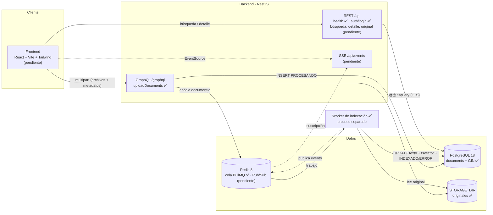

# Arquitectura

> Documento vivo: se actualiza al cerrar cada bloque. Las secciones marcadas *(pendiente)* describen el diseño previsto y todavía no están implementadas.

## 1. Diagrama de arquitectura y flujo

Líneas continuas: implementado. Líneas punteadas: pendiente.

### Flujo de carga (HU-01)

1. ✅ El administrador inicia sesión (`POST /api/auth/login`) y obtiene un JWT de 8 h.
2. ✅ Un middleware rechaza con 401 cualquier petición multipart a `/graphql` sin un Bearer válido, **antes** de leer los archivos.
3. ✅ El cliente envía la mutación `uploadDocuments(files, input)` como `multipart/form-data`. `input.documents[i]` contiene los metadatos de `files[i]`.
4. ✅ El middleware `graphql-upload` interpreta el multipart y aplica `MAX_UPLOAD_BYTES` y `MAX_FILES_PER_UPLOAD`. Apollo rechaza la petición sin la cabecera de preflight (CSRF).
5. ✅ `GqlAuthGuard` vuelve a verificar el token en el resolver, y `ValidationPipe` valida y normaliza los metadatos.
6. ✅ Por cada archivo:
   1. Se valida la extensión.
   2. Se guarda por streaming con un UUID como nombre.
   3. Se verifica que el contenido corresponda a la extensión.
   4. Se inserta la fila `PROCESANDO`.
7. ✅ Se encola el `documentId` en BullMQ (`jobId = documentId`).
8. ✅ La respuesta devuelve `id` + `PROCESANDO` por archivo, sin esperar a la indexación.
9. ✅ El worker (proceso separado) toma el trabajo, lee el original, extrae el texto y, en un solo `UPDATE`, guarda el texto y el `search_vector` y cambia el estado a `INDEXADO`. Ante un fallo del propio documento, el estado pasa a `ERROR` con su causa.
10. *(pendiente)* El worker publica el cambio de estado y la API lo notifica por SSE.

### Responsabilidad de los módulos

| Módulo | Responsabilidad | Estado |
|---|---|---|
| `common/` | Configuración desde el entorno y health check | ✅ |
| `database/` | Configuración de TypeORM y migraciones SQL | ✅ |
| `documents/` | Entidad, carga y almacenamiento, validación de archivos, DTOs | ✅ |
| `graphql/` | Resolvers GraphQL (`uploadDocuments`, `uploadLimits`) | ✅ |
| `auth/` | Login del administrador, emisión y verificación de JWT, guard GraphQL, límite de intentos | ✅ |
| `indexing/` | Cola BullMQ, worker (`worker.ts`), extracción TXT/MD/PDF, construcción del `tsvector`, reintentos y reconciliación | ✅ |
| `search/` | Consultas FTS parametrizadas, ranking y resaltado | ⏳ |
| `events/` | Redis Pub/Sub → SSE | ⏳ |

**Estilo de arquitectura:** modular por capas, con un módulo NestJS por capacidad (resolver/controlador → servicio → repositorio) y un worker en proceso separado. Se descartó una arquitectura hexagonal completa (puertos y adaptadores para cada dependencia): para un alcance de un día añade interfaces de una sola implementación sin beneficio práctico. La separación por módulos ya aísla las responsabilidades y permite extraer el worker o el motor de búsqueda más adelante.

## 2. Justificación de decisiones

### Stack

| Elección | Alternativas consideradas | Motivo |
|---|---|---|
| **NestJS 12** | Express, FastAPI, Spring Boot | Módulos, inyección de dependencias, pipes y guards nativos; TypeScript en todo el stack. La v12 es ESM nativo |
| **GraphQL multipart para la carga** | REST multipart | Aclaración posterior al enunciado. Una sola mutación tipada recibe archivos y metadatos |
| **PostgreSQL FTS** (`tsvector` + GIN) | Elasticsearch, OpenSearch, Meilisearch | Datos e índice en una sola tecnología: sin sincronización entre sistemas y sin un servicio extra que operar. Un motor dedicado se justificaría si las mediciones o el volumen lo exigen |
| **TypeORM** | SQL puro, Prisma | Repositorios y migraciones integrados con Nest. El SQL crítico (esquema FTS, consultas de búsqueda) se escribe a mano y parametrizado, sin depender de las abstracciones del ORM |
| **BullMQ + Redis** | Procesar dentro de la petición; cola en PostgreSQL (`SKIP LOCKED`) | La extracción de PDF puede tardar; la cola desacopla la respuesta, da reintentos y permite escalar workers |
| **SSE** *(pendiente)* | WebSocket, suscripciones GraphQL | Solo se necesita comunicación servidor → cliente. SSE funciona sobre HTTP con reconexión nativa y sin protocolo adicional |
| **Vitest + Supertest** | Jest | Es el runner que genera el CLI de Nest 12; el mismo runner se usará en el frontend |

### Versiones de dependencias

| Hallazgo | Decisión |
|---|---|
| `graphql-upload@18` exige `graphql@17`, pero Apollo Server 5 solo admite `graphql@16` | `graphql-upload@17.1` + `graphql@16` |
| npm 10.9 falla al resolver los *peer dependencies* (`edgesOut`) | Instalación con npm 11 |
| El CLI generó `vite-tsconfig-paths` y `@nestjs/mau` | Eliminados: sin alias de rutas ni despliegue en Mau |

### Carga de documentos

| Decisión | Motivo |
|---|---|
| Archivos y metadatos en argumentos separados, emparejados por índice | La validación de DTOs nunca recorre los streams de los archivos (`Promise<FileUpload>`) |
| Resultado por archivo (`id`+`status` **o** `error`) | En una carga masiva, un archivo inválido no bloquea al resto |
| Validación del contenido real: firma `%PDF-`; UTF-8 sin bytes nulos para TXT/MD | La extensión y el `mimetype` los decide el cliente |
| Nombre en disco = UUID; nombre original saneado solo como metadato | Evita *path traversal* y rutas adivinables |
| `MAX_UPLOAD_BYTES` = 10 MB, inclusivo y configurable | El enunciado no fija un valor; 10 MB es la orientación acordada. busboy corta al **alcanzar** el límite, por eso se le pasa `límite + 1` |
| `csrfPrevention` de Apollo activo | Un formulario de otro sitio puede enviar `multipart/form-data` sin preflight CORS; exigir una cabecera personalizada lo impide |
| HTTP 200 con `PROCESANDO` en el payload (no 202) | En GraphQL el código HTTP indica que la operación se procesó; el estado asíncrono del documento va en los datos |

### Modelo de permisos: administrador único

| Acción | Acceso |
|---|---|
| Subir documentos (`uploadDocuments`) | Solo administrador (JWT) |
| Buscar, ver detalle y visor, consultar `uploadLimits`, health | Público |
| Registro, recuperación de contraseña, roles | No existen (fuera de alcance) |

El enunciado define el actor de HU-01 como "Administrador / Desarrollador" y el de HU-02/03 como "Usuario". La aclaración posterior pide un login para un único administrador.

| Decisión | Alternativa | Motivo |
|---|---|---|
| Credenciales en el entorno: `ADMIN_USERNAME` + `ADMIN_PASSWORD_HASH` | Tabla `users` con semilla | Con un solo usuario, una tabla añade migración, semilla y CRUD sin aportar nada. Si se necesitaran más usuarios, se pasaría a tabla |
| **Hash bcrypt** (`bcryptjs`, coste 12) en el `.env`, nunca la contraseña en claro | argon2 (nativo), `crypto.scrypt` | El kata pide bcrypt o argon2. `bcryptjs` es JavaScript puro: no necesita scripts de instalación nativos, que npm 11 pide aprobar explícitamente (`allowScripts`, observado al instalar `@apollo/protobufjs`) y que suelen dar problemas de compilación en Windows. Mismo formato `$2b$` que bcrypt |
| `npm run hash-password` lee la contraseña **sin eco** | Pasarla como argumento | Un argumento queda en el historial de la shell y en la lista de procesos |
| Hash entre comillas simples en `.env` | Sin comillas | El hash contiene `$`, y las comillas simples evitan que se interprete como variable. Verificado con `process.loadEnvFile`; con Docker Compose se verificará al dockerizar la API |
| **Arranque fallido** si `JWT_SECRET` tiene menos de 32 caracteres o `ADMIN_PASSWORD_HASH` no es bcrypt | Valores por defecto | Es preferible que la API no levante a que levante con un secreto débil. El `.env.example` deja ambos vacíos a propósito |
| JWT HS256, 8 h, sin refresh token | Sesión en servidor, refresh tokens | API sin estado entre peticiones (escala sin sesión compartida). 8 h cubren una jornada; un refresh token añade almacenamiento y rotación sin aportar a una demo |
| Algoritmo fijado al verificar (`algorithms: ['HS256']`) | Aceptar el del token | Impide ataques de confusión de algoritmo (`alg: none`) |
| bcrypt se ejecuta aunque el usuario no exista; usuario comparado en tiempo constante; mismo mensaje para ambos fallos | Responder antes | No revela si el usuario existe, ni por el mensaje ni por el tiempo de respuesta |
| Límite de **5 intentos por IP y minuto** en el login (`@nestjs/throttler`, 429) | Sin límite | Frena la fuerza bruta. Límite conocido: el contador vive en memoria por instancia; con réplicas, almacenarlo en Redis |
| **Middleware** que rechaza el multipart sin token **antes** de `graphql-upload` | Solo el guard del resolver | El guard se ejecuta después de que `graphql-upload` reciba los archivos: un anónimo podría hacer que el servidor recibiera hasta 10 × 10 MB por petición |
| **Además**, `GqlAuthGuard` en la mutación | Solo middleware | Autorización declarativa en el resolver (lo pide el kata). Protege cualquier mutación futura que no sea multipart (defensa en profundidad) |
| Sin revocación de tokens | Lista negra en Redis | Con un único administrador y una caducidad de 8 h, rotar `JWT_SECRET` basta para invalidar todos los tokens |

### Modelo de datos (migración `CreateDocuments`)

| Decisión | Motivo |
|---|---|
| `id UUID` | No enumerable. Se genera antes del INSERT y sirve también como nombre en disco |
| `tags TEXT[]` | Las etiquetas solo se muestran e indexan; un arreglo evita un JOIN con una tabla N:M |
| `status TEXT` + `CHECK (PROCESANDO, INDEXADO, ERROR)` | Estados del enunciado impuestos por la base de datos. Un `CHECK` es más fácil de evolucionar que un `ENUM` de Postgres |
| `CHECK (status <> 'INDEXADO' OR search_vector IS NOT NULL AND indexed_at IS NOT NULL)` | La base de datos impide marcar un documento como INDEXADO sin su índice |
| `content_indexed BOOLEAN` + `CHECK (NOT content_indexed OR extracted_text IS NOT NULL)`, en una **segunda migración** (`AddContentIndexed`) | Distingue los documentos indexados con contenido de los indexados solo por metadatos. Se añadió con una migración nueva, sin editar la anterior, como se haría con datos en producción. `down()` verificado: revertir y volver a aplicar |
| `storage_path` relativo a `STORAGE_DIR` | Permite mover el almacenamiento (o pasarlo a almacenamiento de objetos) sin reescribir filas |
| `search_vector` lo escribe el worker, no una columna generada | `array_to_string` no es `IMMUTABLE` (comprobado: `provolatile = s`). Además, un solo `UPDATE` hace atómica la transición a INDEXADO |
| SQL escrito a mano; `synchronize: false` | El esquema de búsqueda debe ser explícito y revisable |
| `migrationsRun: true` | La API migra al arrancar. Para varias réplicas pasaría a un paso del despliegue |

### Indexación: cola, concurrencia, reintentos e idempotencia

| Decisión | Alternativa | Motivo |
|---|---|---|
| **Worker en proceso separado** (`dist/worker.js`) | Procesar en la API | La extracción de PDF consume CPU y bloquearía el event loop de la API. Además, el worker escala de forma independiente (más réplicas) |
| `jobId = documentId` | Id aleatorio | Encolar dos veces el mismo documento no crea dos trabajos |
| `UPDATE … WHERE status = 'PROCESANDO'` en indexación y en error | Actualizar sin condición | **Idempotencia**: un reintento, un trabajo duplicado o dos workers con el mismo documento nunca reindexan ni pisan un estado final. Probado: reprocesar un documento `INDEXADO` lo deja igual |
| Un solo `UPDATE` con texto, `search_vector`, estado e `indexed_at` | Varios pasos | Transición atómica: nunca hay un `INDEXADO` sin índice (además lo garantiza el `CHECK` de la tabla) |
| **Errores definitivos** (PDF dañado o protegido, archivo inexistente, `tsvector` de más de 1 MB) → `ERROR` sin reintentar | Reintentar todo | Reintentar un PDF dañado da el mismo resultado; solo retrasa el aviso al usuario |
| **Sin texto extraíble** (PDF escaneado, archivo en blanco) → `INDEXADO` solo por título y metadatos, con `content_indexed = false` (*decisión del propietario*) | `ERROR`; OCR | El documento sigue siendo útil y localizable por sus metadatos, y la marca permite identificarlo y avisarlo en la interfaz. OCR (p. ej. Tesseract) queda fuera del alcance |
| **Errores transitorios** (BD o Redis caídos) → 3 intentos con espera exponencial (2 s, 4 s); agotados → `ERROR` | Sin reintentos | Una caída breve no debe marcar documentos válidos como erróneos |
| **Reconciliación** al arrancar el worker: reencola los `PROCESANDO` | Aceptar documentos atascados | Si Redis falla justo después del INSERT, la API registra el error, responde `PROCESANDO` y el documento se recupera al reiniciar el worker. Límite: no es periódica; con un `JobScheduler` de BullMQ lo sería |
| Concurrencia configurable (`INDEXING_CONCURRENCY`, por defecto 2) | Fija | Ajustable según la CPU disponible; se aplica en tiempo de ejecución (el decorador se evaluaría antes de cargar `.env`) |
| Redis con AOF y `noeviction` | Configuración por defecto | Los trabajos sobreviven a un reinicio de Redis y nunca se descartan por memoria |
| **`unpdf`** para PDF | `pdf-parse`, `pdfjs-dist` | Sin dependencias (trae pdfjs empaquetado). `pdf-parse` 2.x arrastra un binario nativo (`@napi-rs/canvas`) |
| Markdown indexado en bruto | Convertirlo a texto plano | El parser de PostgreSQL ya descarta `#`, `*` y `>` al construir el `tsvector`; convertirlo añadiría dependencias sin cambiar el índice |
| Se eliminan los caracteres NUL del texto extraído | — | PostgreSQL no admite `\0` en `TEXT`, y algunos PDF lo producen |

### Diseño del índice full-text

- **Índice GIN** sobre `search_vector`. Es un índice invertido (lexema → filas): `search_vector @@ tsquery` no recorre la tabla, a diferencia de `LIKE '%x%'`. Se prefiere a GiST porque es más rápido en lectura, y aquí se lee mucho más de lo que se escribe.
- ✅ **Pesos** con `setweight`: título **A**; autor, categoría, versión y etiquetas **B**; contenido extraído **C**. Verificado en pruebas (`nginx:C` coincide y `nginx:A` no).
- ✅ **Diccionario `simple`:** normaliza a minúsculas sin stemming ni stopwords. Un corpus técnico mezcla español, inglés y términos propios (`k8s`, `pg_dump`, nombres de API) que un diccionario de idioma podría recortar o descartar. Limitación: "documento" no coincide con "documentos", y las palabras vacías ("de", "la") también se indexan.
- **Límite de PostgreSQL:** un `tsvector` ocupa como máximo 1 MB (SQLSTATE `54000`). Medido: 10 MB de texto con 20 000 términos distintos se indexan sin problema; unas 300 000 palabras distintas lo superan, y el documento pasa a `ERROR` con su causa.
- **Sin texto extraíble:** el vector contiene solo los lexemas A y B (título y metadatos), y `content_indexed = false`.
- *(pendiente)* Consulta con `websearch_to_tsquery`, ranking `ts_rank_cd` y fragmentos con `ts_headline`. Verificado de forma manual: encuentra términos dentro del PDF, la frase exacta `"pg_dump y restauración"` y etiquetas.
- Índice `(created_at DESC, id DESC)` para listados y como desempate estable de la paginación.

### Latencia objetivo (400–1000 ms) *(pendiente)*

El objetivo se interpreta como un máximo de 1 s: una respuesta más rápida cumple, y no se añade ningún retardo artificial. Se medirá la latencia HTTP de extremo a extremo (promedio y p95) con un volumen de datos representativo, junto con `EXPLAIN (ANALYZE, BUFFERS)`.

## 3. Estrategia de tiempo real *(pendiente)*

Diseño previsto:
1. El worker publica el cambio de estado en Redis Pub/Sub.
2. La API retransmite el evento por SSE.
3. Al conectar o reconectar, el cliente consulta el estado actual, porque Pub/Sub no conserva los mensajes. PostgreSQL es la fuente de verdad.

## 4. Escalabilidad *(pendiente de completar)*

- La API no guarda estado entre peticiones (JWT, archivos en almacenamiento compartido), así que admite réplicas detrás de un balanceador.
- Los workers escalan de forma horizontal sobre la misma cola.
- El índice GIN crece con el número de lexemas distintos, no de forma lineal con las filas, y la búsqueda está paginada.
- Evolución posible: almacenamiento de objetos para los originales, particionado de la tabla o un motor de búsqueda dedicado si las mediciones lo justifican.

## 5. Desviaciones respecto a la estructura de referencia

| Referencia | Implementado | Motivo |
|---|---|---|
| Migraciones en `backend/migrations/` | `backend/src/database/migrations/` | Dentro de `src/` las compila `nest build` y se importan como clases, que funciona igual en ESM, en `dist/` y en Vitest (los globs de archivos no) |
| `.env.example` en la raíz | `backend/.env.example` | La API carga `.env` desde su propio directorio de trabajo |
| — | `docker/postgres/init/` | Script de inicialización que crea la base `documents_test` |
| `packages/shared/` (opcional) | No se crea | Por ahora no hay tipos duplicados entre capas que lo justifiquen. Se reevaluará con el frontend |

## 6. Limitaciones conocidas

- Límite de intentos de login en memoria por instancia (ver modelo de permisos).
- No hay revocación de tokens antes de su caducidad.
- Sin OCR: un PDF escaneado solo se encuentra por título y metadatos (`content_indexed = false`).
- La reconciliación de documentos atascados ocurre solo al arrancar el worker, no de forma periódica.
- No se ha probado la carga con Redis caído. Por diseño, el documento queda registrado y se recupera con la reconciliación, pero no se ha medido cuánto tarda en responder `queue.add` mientras Redis no está disponible.
- Las migraciones se ejecutan al arrancar la API; no es apto para varias réplicas sin un paso de despliegue dedicado.
