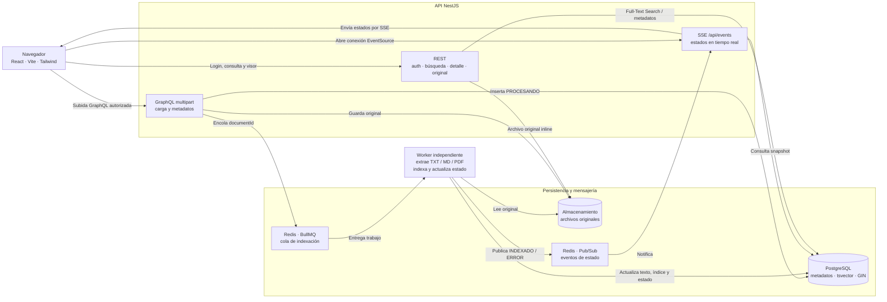
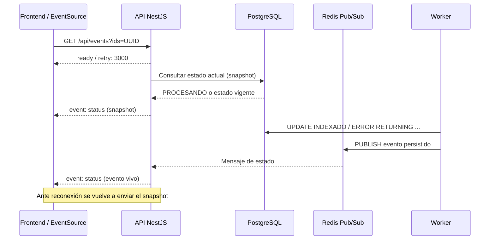

# Arquitectura — Buscador y Visor de Documentos Técnicos

> **Alcance:** descripción de la solución implementada y de sus límites conocidos. Este documento responde a los cuatro apartados obligatorios del punto 6.1 de la prueba. Las optimizaciones futuras se indican expresamente como propuestas, no como funcionalidades desarrolladas.

## 1. Diagrama de Arquitectura / Flujo

La solución sigue una **arquitectura modular por capas** (NestJS) con un **worker independiente** para el procesamiento de documentos. PostgreSQL almacena los metadatos, el texto extraído y el índice de búsqueda. Redis coordina la cola de trabajos y distribuye eventos; los originales se guardan en almacenamiento de archivos.

**Nota:** PostgreSQL Full-Text Search es un motor **integrado en PostgreSQL**, no una base de datos adicional. Redis se representa en dos funciones lógicas (BullMQ y Pub/Sub), aunque pertenece a la misma tecnología.

### Flujo de carga e indexación (HU-01)

1. El administrador inicia sesión por `POST /api/auth/login` y recibe un JWT.
2. El frontend envía archivos TXT, MD o PDF y metadatos mediante la mutación `uploadDocuments` (GraphQL multipart). La API valida autenticación, tamaño, formato y contenido del archivo.
3. Cada original se guarda con identificador UUID; se crea su registro en PostgreSQL con estado **`PROCESANDO`** y se encola el trabajo con `jobId = documentId`.
4. La API responde **sin esperar el procesamiento** con el ID y el estado del documento.
5. El worker extrae el texto, construye `search_vector` y actualiza atómicamente el registro a **`INDEXADO`**; ante errores definitivos pasa a **`ERROR`**. Un PDF sin texto extraíble puede quedar `INDEXADO` solo por metadatos, con `content_indexed = false`.
6. Tras persistir el nuevo estado, el worker publica un evento en Redis; NestJS lo reenvía al frontend mediante SSE.

### Flujo de búsqueda y visualización (HU-02 y HU-03)

1. `GET /api/documents?query=...&page=...&pageSize=...` valida los parámetros y consulta únicamente documentos `INDEXADO`.
2. PostgreSQL transforma la consulta con `websearch_to_tsquery('simple', $1)` y filtra con `search_vector @@ ...`, apoyado en un **índice GIN**. No utiliza `LIKE`/`ILIKE` para buscar contenido.
3. Los resultados se ordenan por `ts_rank DESC`, fecha e ID, con paginación `LIMIT/OFFSET`. El total se calcula en una consulta aparte con un límite configurable de coincidencias; los fragmentos (`ts_headline`) se generan **solo para los registros de la página**.
4. La API devuelve los fragmentos como segmentos de texto y coincidencia para evitar insertar HTML arbitrario. El frontend destaca coincidencias de forma segura.
5. `GET /api/documents/:id` entrega metadatos y estado; `GET /api/documents/:id/original` muestra el **PDF original embebido** (`inline` y `Range`) o el texto/Markdown renderizado en el navegador.

### Responsabilidades principales

| Componente | Responsabilidad |
|---|---|
| React + Vite + Tailwind | Login, carga, búsqueda, paginación, visor y estados reactivos. |
| NestJS / GraphQL | Validación, autorización y recepción de archivos con metadatos. |
| NestJS / REST | Autenticación, búsqueda, detalle y entrega del original. |
| PostgreSQL + TypeORM | Persistencia y migraciones; SQL específico para FTS e índices GIN. |
| Redis + BullMQ | Cola, reintentos y distribución de trabajos de indexación. |
| Worker independiente | Extracción de texto e indexación sin bloquear la API. |
| Redis Pub/Sub + SSE | Propagación de estados del worker al navegador sin polling periódico. |

## 2. Justificación de Decisiones

La selección prioriza **bajo costo operativo, claridad arquitectónica y capacidad de demostrar la búsqueda con latencia inferior a 1 segundo** en el entorno medido. Se eligió una arquitectura modular por capas, en lugar de una arquitectura hexagonal completa, para mantener una separación clara de responsabilidades sin añadir abstracciones que no aporta el alcance de la prueba.

| Tecnología / decisión | Alternativa evaluada | Justificación técnica |
|---|---|---|
| **NestJS + TypeScript** | Express, FastAPI, Spring Boot | Modularidad, inyección de dependencias, validación, guards y contratos tipados. |
| **React + Vite + Tailwind** | Next.js, Angular | Aplicación SPA sin necesidad de SSR; compilación rápida y sistema visual consistente. |
| **GraphQL multipart** para carga | REST multipart | Permite enviar el lote de archivos con metadatos tipados, conforme a la aclaración del ejercicio. |
| **REST** para búsqueda y detalle | Todo por GraphQL | Endpoints simples, paginables y adecuados para servir el PDF original con cabeceras HTTP. |
| **PostgreSQL Full-Text Search** | Elasticsearch / OpenSearch | Índice y metadatos en el mismo motor: evita sincronización adicional y reduce infraestructura para la escala evaluada. |
| **Índice GIN sobre `tsvector`** | `LIKE`, índice GiST | Índice invertido para encontrar términos sin recorrer todo el contenido; favorece consultas de lectura. |
| **TypeORM + SQL parametrizado** | Solo ORM / solo SQL | Repositorios y migraciones para persistencia común; control explícito del índice, ranking y consulta FTS. |
| **BullMQ + Redis + worker** | Indexar dentro de la petición | Respuesta de carga inmediata, reintentos e indexación desacoplada del servidor HTTP. |
| **SSE + Redis Pub/Sub** | WebSocket | El requisito es unidireccional (servidor a cliente); SSE utiliza HTTP y reconecta automáticamente. |
| **Docker Compose** | Instalación manual de servicios | Arranque reproducible de PostgreSQL y Redis y entorno consistente para pruebas. |

### Diseño de búsqueda y rendimiento (400 ms – 1 s)

- **Objetivo interpretado:** tiempo de respuesta de búsqueda **máximo 1 segundo**; una respuesta menor de 400 ms es favorable y no requiere introducir retrasos artificiales.
- **Índice:** `tsvector` con ponderación por campos: título **A**, metadatos **B** y contenido **C**. El diccionario `simple` conserva términos técnicos multilingües, sin stemming.
- **Ranking:** se utiliza `ts_rank` en lugar de `ts_rank_cd`: ambos consideran los pesos, pero las mediciones mostraron menor costo para `ts_rank` en consultas amplias.
- **Paginación y fragmentos:** orden estable (`rank`, `created_at`, `id`), conteo con tope y cálculo de `ts_headline` únicamente para la página, sobre una porción limitada del contenido.
- **Seguridad:** consultas parametrizadas; fragmentos convertidos en segmentos `{ text, match }` para evitar XSS; acceso a carga restringido a un administrador JWT.

**Resultados registrados en el benchmark del proyecto** (10.000 documentos sintéticos, medición local; p95 HTTP antes y después de optimizar):

| Escenario | Antes | Después |
|---|---:|---:|
| Término frecuente | 772 ms | **277 ms** |
| Dos términos | 1.199 ms | **418 ms** |
| Frase exacta | 1.243 ms | **462 ms** |
| Consulta OR | 842 ms | **294 ms** |
| Página 50 | 545 ms | **343 ms** |
| 10 clientes concurrentes | 2.078 ms | **778 ms** |

Los resultados posteriores se sitúan por debajo del máximo de 1 s **en los escenarios medidos**. No constituyen una garantía de rendimiento para cualquier volumen, infraestructura o consulta. La metodología, el corpus, las consultas y los planes de ejecución se documentan en [`benchmark.md`](benchmark.md).

## 3. Estrategia de Tiempo Real

La HU-04 exige que la interfaz conozca la finalización de la indexación **sin refrescar manualmente ni consultar el estado periódicamente**. El sistema utiliza Redis Pub/Sub entre el worker y NestJS y SSE entre NestJS y el navegador.

**Criterios de consistencia y operación:**

1. **Fuente de verdad:** PostgreSQL. Redis Pub/Sub distribuye notificaciones, pero **no conserva** los eventos para entregarlos después.
2. **Snapshot + eventos vivos:** cada conexión SSE recibe el estado actual y posteriores cambios; la suscripción al canal en vivo se habilita antes de consultar el snapshot para reducir el riesgo de pérdida entre ambos pasos.
3. **Orden temporal:** cada evento contiene `updatedAt`; el cliente aplica el estado más reciente, porque un snapshot puede llegar después de un evento nuevo.
4. **Reconexión:** `EventSource` vuelve a conectar (configuración `retry: 3000`) y el snapshot permite recuperar cambios ocurridos durante una desconexión.
5. **Eficiencia:** una suscripción Redis por instancia de API puede distribuir estados a múltiples clientes. `?ids=` limita los documentos observados.
6. **Confiabilidad de procesamiento:** BullMQ mantiene reintentos para errores transitorios y el worker utiliza `jobId = documentId` y actualizaciones condicionadas para evitar dobles cambios de estado; la reconciliación al arrancar recupera documentos `PROCESANDO` sin trabajo activo.

**Limitación documentada:** si Redis falla y un cliente SSE permanece conectado, un evento perdido puede no reflejarse hasta su siguiente reconexión; no existe un snapshot periódico. Tampoco se ha verificado experimentalmente la carga completa con Redis caído.

## 4. Escalabilidad

La arquitectura separa recepción HTTP, persistencia, búsqueda, procesamiento y eventos. Esto permite ampliar componentes por separado, pero **no significa que la configuración local actual escale automáticamente a varios servidores**.

| Componente | Capacidad actual | Adaptación ante crecimiento masivo |
|---|---|---|
| **API NestJS** | Sin sesiones de usuario almacenadas en la API; JWT firmado. | Añadir réplicas y balanceador, **después de** disponer de almacenamiento compartido y migraciones separadas del arranque. |
| **Worker + BullMQ** | Proceso independiente y concurrencia configurable; cola amortigua picos. | Aumentar procesos worker y ajustar concurrencia según CPU, memoria y capacidad de PostgreSQL. |
| **PostgreSQL FTS + GIN** | Consultas indexadas y paginadas; benchmark con 10.000 documentos. | Ajustar recursos e índices, estudiar réplicas de lectura; si el ranking de consultas muy amplias supera el SLA, valorar RUM o un buscador dedicado. |
| **Redis** | BullMQ para trabajos y Pub/Sub para estados entre procesos. | Monitorear memoria, persistencia, reconexión y capacidad de cola; mantener Pub/Sub desacoplado de la fuente de verdad. |
| **Archivos originales** | `STORAGE_DIR` en disco local. | Migrar a S3 o almacenamiento compartido: **necesario** antes de usar réplicas distribuidas de API/worker. |
| **Eventos SSE** | Una suscripción Redis por instancia de API; reconexión nativa. | Varias instancias detrás de proxy con soporte para conexiones largas y timeouts apropiados. |

### Cuello de botella y alternativas

El índice GIN localiza coincidencias con rapidez, pero **ordenar por relevancia requiere puntuar los documentos que coinciden**. Con consultas muy generales y un corpus mayor, ese cálculo aumenta. Los valores medidos con 10.000 documentos no se extrapolan como garantía para 100.000 o millones.

Evolución propuesta, según mediciones futuras:

1. Optimizar configuración de PostgreSQL, planes de ejecución y límites de paginación/ranking.
2. Distribuir las consultas de lectura y el procesamiento en infraestructura escalable, con almacenamiento común y métricas de cola.
3. Si el volumen y el comportamiento de búsqueda lo justifican, evaluar un motor dedicado (OpenSearch/Elasticsearch) y un mecanismo consistente de sincronización de índices.

### Restricciones conocidas que condicionan la escala

- El almacenamiento de originales es local; los archivos deben centralizarse antes de un despliegue multinodo.
- Las migraciones se ejecutan al iniciar la API; con varias réplicas deben pasar a un paso exclusivo de despliegue.
- El limitador de intentos de login utiliza memoria por instancia; para escalado horizontal necesita un almacenamiento compartido.
- El `tsvector` de PostgreSQL tiene un límite interno de tamaño; se controla el error de documentos que lo exceden.
- No se incluye OCR: un PDF escaneado puede buscarse por título y metadatos, no por texto dentro de las imágenes.
- La reconciliación de trabajos pendientes se realiza al arrancar el worker, no periódicamente.
